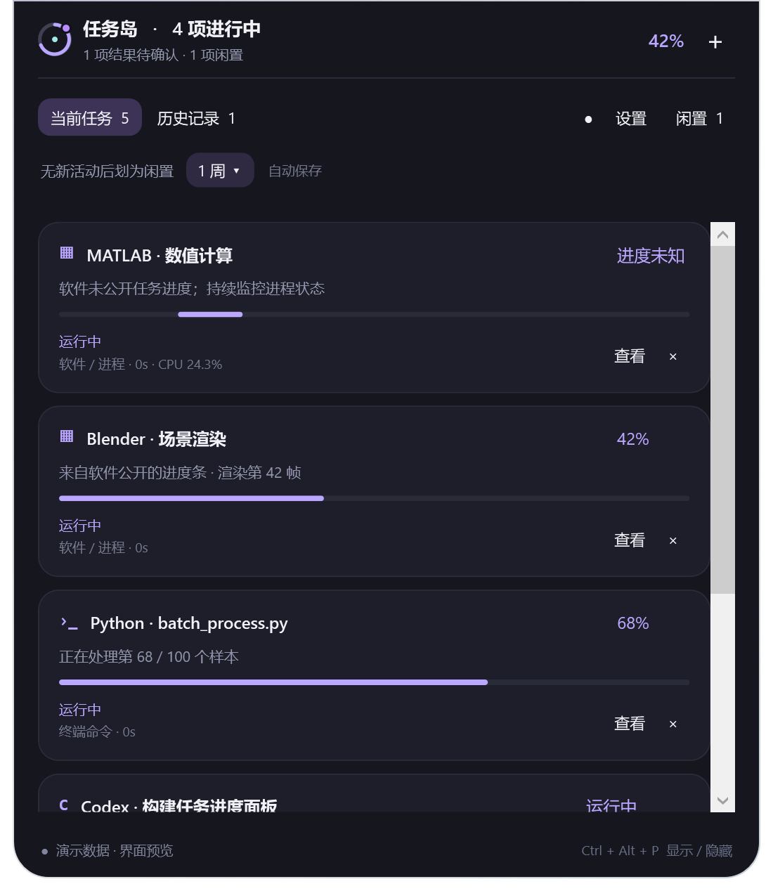

# 任务岛 · Progress Island

Windows 上的工作进度灵动岛。把 Codex 会话、代码、脚本和软件任务放到屏幕边缘；悬停展开，离开收起，完成或失败时提醒。



GitHub 现成项目核查和实现选择见 [docs/RESEARCH.md](docs/RESEARCH.md)。这是独立实现的 Windows 原生版本，不是 Agent HUD 或 Token Monitor 的移植。

## 启动

便携包：解压后双击 `app/ProgressIsland.exe`，或者运行 `Start-ProgressIsland.ps1`。

源码：需 Windows 10/11 和 .NET 9 SDK。

```powershell
.\Start-ProgressIsland.ps1
```

首次启动自动读取本机 Codex 的未归档用户会话，并支持自动发现 Python、MATLAB、Rscript、FFmpeg、Blender、7z、MSBuild、CMake、Ninja 等常见进程。自动发现进程仅表示进程存在，不代表应用内部一定正在执行任务。

- 悬停展开；点击“＋”接入任务。
- 拖动岛到屏幕边缘并松开：上下边缘横向，左右边缘竖向；沿边缘的位置会记住。
- 悬停向屏幕内侧展开，移开收回。点击“固定”保持展开。
- 任务较多、收起条带较长时，展开位置会沿边缘调整，保持鼠标位于面板内；静止悬停不会因布局切换而反复展开 / 收起。按 `Esc` 收起后，移开再悬停即可重新展开。
- 托盘右键 → 停靠位置，也可直接选择四条边缘。
- `Ctrl+Alt+P` 显示 / 隐藏；系统托盘也可操作。
- 设置内可关闭自动发现、GUI 进度读取、通知或提示音。
- 设置内可勾选“开机自启动”，保存后在登录当前 Windows 账号时自动显示任务岛；取消勾选并保存即可关闭，无需管理员权限。
- “×”只移除监控，不终止工作；没有结束其他软件的按钮。
- 点击“查看”可看详情、切回软件；软件 / 日志任务支持在核实结果后手动标记完成或失败。
- 默认“当前任务”同时列出所有进行中的任务和尚未确认的结束结果。收起后每个任务仍保留独立条目，上下边缘横向排列，左右边缘竖向排列；条目多于屏幕可用空间时滚动查看。
- 结束结果显示紫色未读点。点击收起状态的结束条目，或展开后的“确认”，会清除标记并移出当前任务；记录保留在“结束记录”中。右键标记未读后会重新出现。
- “闲置”入口始终放在横向岛最右侧、竖向岛末尾和展开控制栏最右侧，不与当前任务混排。
- 展开界面直接点击“无新活动后划为闲置”旁的时长，可选择分钟、小时、天、周的预设，也可自定义；立即重新分组并自动保存。默认仍为一周。
- “历史记录”包含过往已结束的会话，不是待确认数量；历史页会注明总数和待确认数，当前任务只保留进行中与未确认结果。
- Codex 卡片点击“打开会话”会跳转到对应聊天并标记已读。只悬停展开不会清除未读点。
- 从岛启动的命令由独立监控进程托管，退出岛不会主动停止命令；重新打开岛可读取保留的进度和退出结果。

## 接入方式

| 方式 | 操作 | 准确度与边界 |
|---|---|---|
| Codex 会话 | 默认自动接入；设置内可关闭 | 所有未归档用户会话的最新轮次状态，没有可靠百分比时不估算。 |
| 终端外部命令 | 自动发现 Windows Terminal、VS Code 终端及常见控制台的外部命令 | 显示命令 / 项目名称，合并同一命令的子进程；只观察到进程退出时标记结果未验证。 |
| 运行命令 | “＋ → 运行命令”，填写 PowerShell 命令和工作目录 | stdout / stderr 中的进度；退出码决定最终成功 / 失败。用于非交互命令，不支持需要手动输入密码等交互操作。 |
| 已有程序 | “＋ → 已有程序”，搜索程序名 / PID 或选择窗口 | 标准 UI Automation 进度条；多个进度条或没有公开数据时显示未知。关闭软件不代表内部工作成功。 |
| 跟随日志 | “＋ → 跟随日志”，选择 UTF-8 日志 | 只跟随进度，不根据日志静默猜测成功。轮转为更小文件可检测；同长度覆盖 / 路径替换未保证识别。 |
| 脚本上报 | 使用 `sdk`，或“＋ → 脚本上报”复制示例 | 程序自行知道总量及结果，最适合准确的完成提醒。 |

命令输出支持：

```text
Processing 42%
Epoch 3/10
step 100/250
 35%|████████ | 35/100 [00:03]
Duration: 00:02:00.00
frame=50 fps=30 time=00:01:00.00
{"progress":68,"message":"处理第 68 / 100 个样本"}
```

**日志自动解析仅是启发式。** Accuracy / CPU 等常见资源或指标行不会用作进度，但不能识别所有自定义日志含义。多阶段工作请显式上报总进度。这里的 `progress` 一律为 **0–100**。

**进程退出、资源空闲、阶段 100%、不再输出日志，都不等于软件内部任务成功。** 对于不公开进度的 MATLAB / 渲染器 / 自定义界面，需要加 SDK、提供日志，或再开发专用适配器。管理员权限运行的软件可能无法被普通权限读取；应用不会自行提权。

## Codex 会话与未读

每个会话只显示最新一轮。同一会话继续发送消息后，会从“运行结束”回到“运行中”；结束仅代表本轮停止运行，不代表长期目标或整个项目完成。失败和中断也归入“运行结束”，保留各自状态。

默认 **一周（7 天）无新活动**后移入“闲置”。展开界面支持 30 分钟、1 / 6 小时、1 / 3 天、1 / 2 周和 30 天，也可自定义 1 分钟到 365 天；近期暂停或等待中的任务仍保留在当前任务，达到同一闲置阈值后再移入闲置。Codex 使用当前轮次项目的时间和会话记录文件的修改时间判断近期活动，只读文件时间，不读取会话正文；缺少这些信息时才回退到会话元数据时间。长期遗留的 `inProgress` 不再一直占据当前任务。

闲置只调整展示分组，不修改原始执行状态，也不推断成功、失败或停止。卡片显示多久没有新活动，停止忙碌动画；有新输出后自动回到运行中。**长时间静默的计算仍可能在执行**，可提高闲置时间。普通任务的新日志、进度变化、脚本心跳或可观察的 CPU 活动会刷新活动时间；定时采样、重复读取相同命令结果、打开或标记已读不会假造新工作活动。CPU 活动只用于区分近期活动，不换算完成百分比。

默认读取 `%USERPROFILE%\.codex`，也支持 `CODEX_HOME`。通过 Windows 内置 SQLite 以只读方式获取 `state_*.sqlite` 和 `thread_history_*.sqlite` 的会话标题、最新轮次状态及时间；用 `session_index.jsonl` 获取标题，用 `.codex-global-state.json` 的会话未读与活动记录同步已读状态。不会调用模型、读取凭据或读取对话正文；不会修改 Codex 的数据库、未读数据或运行中的会话。

- 自动未读以 Codex 本机记录为准：新结果尚未查看时亮紫点；在 Codex 中打开对应会话后同步清除。
- 右键“标记为未读”是任务岛自己的标记，会保存并跨重启保留；重复的旧快照不会马上清掉。再次打开对应会话、出现新的真实查看记录或手动标记已读时清除。
- 查看正在运行的会话，不会提前把它之后产生的新结果视为已读。
- 横向岛、竖向岛和每张卡片均显示未读点，结束标签显示未读数量。普通任务打开详情后标记已读。
- 扫描所有未归档的用户会话，不混入子代理，不再限制最近 60 个会话或列表前 50 项。新一轮覆盖同会话的上一轮卡片。移除卡片只停止岛内监控，不会删除或停止 Codex 会话。
- 本地数据格式属于 Codex 桌面版内部实现，升级后可能需要适配。无法识别已读结构时，新结束结果保守标记未读；无法读取数据库时会显示提示，不根据日志静默推断完成。

状态含义参考 [OpenAI App Server 文档](https://learn.chatgpt.com/docs/app-server)。当前实现读取桌面版实际的本地记录，不另起一个 App Server 来猜桌面会话是否在运行。

## Python 名称和终端命令

Python 优先显示实际脚本名，例如 `Python · train_model.py`；`python -m package.worker` 显示模块名。中文和带空格的文件名可识别。`-c` 显示“内联代码”，`-` 显示“标准输入”，交互式解释器单独注明。读取不到时显示“代码名称未知”，可手动填写标题，不会把完整参数或内联源码当成任务标题。

终端中的外部命令也作为任务，例如 `npm run build`、`dotnet build · Example.csproj`、Node / Python 脚本等。根据终端与 shell 的进程关系识别命令的根进程，同一条命令的子进程尽量合并。空闲终端不单列。已由任务岛启动并托管的命令，其子进程不会重复添加。

自动发现约每 6 秒执行一次，极短命令可能在采样前结束；`cd`、`echo`、PowerShell 管道 / 内置命令等不一定产生独立进程，应从“＋ → 运行命令”启动或显式上报，才能完整监控。本功能观察 Windows 外部进程，不读取终端屏幕，不接管已有终端的输出，也不保证读取 WSL 内部任务。外部任务只观察到退出时归为“已退出 · 未验证”，待你确认；从岛启动的命令根据实际退出码判定成功 / 失败。

名称读取放在后台，通过 Windows 的 [Win32_Process 元数据](https://learn.microsoft.com/en-us/windows/win32/cimwin32prov/win32-process) 和 [命令行参数解析接口](https://learn.microsoft.com/en-us/windows/win32/api/shellapi/nf-shellapi-commandlinetoargvw)取得脚本 / 模块名称。只保留名称，不保存完整命令参数；查询有并发和超时限制，失败可后台重试，不阻塞鼠标交互。

## Python

无第三方依赖；Python 3.10+。把 `sdk/progress_island.py` 放到你的脚本旁或导入路径。

```python
from progress_island import Task

with Task("数据批处理") as task:
    for i in range(100):
        process_one(i)
        task.update(i + 1, total=100, message=f"样本 {i+1}/100")
```

上下文正常结束自动完成；异常时上报失败并继续抛出原异常。上报失败只警告，不中止计算。每次工作使用新的任务 ID，已结束任务不会被迟到记录重新激活。示例：`examples/python_report.py`。

只想测试自动发现和脚本名时，在项目目录运行下面的示例。默认约 60 秒，每批输出百分比；可用 `--seconds 20` 调整时长。

```powershell
py .\examples\island_test.py
```

从普通终端启动时，可测试名称、运行状态和退出提示。将同一条命令填入岛的“＋ → 运行命令”，并将工作目录设为项目目录，可测试输出百分比和退出结果。

## PowerShell

```powershell
. .\sdk\ProgressIsland.ps1
$jobId = [guid]::NewGuid().ToString('N')
Send-IslandProgress -Id $jobId -Title '批量处理' -Progress 35 -Message '处理第 35 批'
# 工作完成后
Send-IslandProgress -Id $jobId -Title '批量处理' -Status completed -Message '处理完成'
```

更多示例见 `examples/powershell_report.ps1`、`examples/console_progress.ps1`。命令示例可从岛中运行：

```powershell
1..30 | ForEach-Object { Write-Output "progress $([int]($_ / 30 * 100))%"; Start-Sleep -Milliseconds 250 }
```

若 Windows PowerShell 的本机执行策略不允许加载 `.ps1`，可以直接使用界面复制的内联上报示例或 Python SDK；任务岛不修改系统执行策略。调用已有脚本时请遵循电脑当前策略。

## 本机 HTTP 接口

默认 `http://127.0.0.1:47832`。所有接口均要求 `Authorization: Bearer <token>`。令牌保存在当前用户的 `%LOCALAPPDATA%\ProgressIsland\settings.json`，不要公开此文件。不监听局域网、不提供 CORS、不允许 HTTP 启动程序或读取文件。

| 路径 | 用途 |
|---|---|
| `GET /health` | 存活检查 |
| `GET /tasks` | 本机任务快照 |
| `POST /tasks` | 新建 / 更新上报任务 |

```json
{"id":"a-new-id-for-each-job","title":"MATLAB 批处理","progress":35,"detail":"样本 35/100","status":"running"}
```

状态：`running`、`paused`、`waiting`、`completed`、`failed`。`progress` 可省略；`clearProgress:true` 撤销失效的百分比。不能通过接口覆盖命令 / 软件 / 日志来源的任务。任务最多 500 项，界面历史显示最近 50 项。

## 数据与运行方式

- 默认数据目录 `%LOCALAPPDATA%\ProgressIsland`，含设置、任务快照和命令最新进度；没有遥测、账号登录或云同步。
- 本程序本身不向外联网；用户从岛启动的命令可以按其原有行为联网。
- 只保存最近一条命令 / 日志输出，不保存完整日志；输出中若有敏感内容也可能出现在本地记录。日志原件不修改。
- 启动命令请求文件在独立进程读入后删除；命令结果暂存 `commands` 目录，以便关闭 / 重开岛后恢复。清空界面历史不会自动删除这些状态文件。
- 异常退出后，外部上报 / 日志 / 软件任务历史标记“监控中断”，不冒称完成；命令任务检查独立监控进程及保留结果。
- 不安装服务，不注入目标进程，不读取模型凭据。开机自启动默认关闭；由你在设置中启用，仅添加当前用户的 Windows 登录启动项，不影响其他软件的启动项。
- 软件进度读取采用独立子进程，单次查询最多约 2 秒；系统进程扫描约 6 秒，生命周期刷新约 2 秒。大量慢响应软件会延长整体刷新周期。
- GUI 查询使用可复用的低优先级独立进程，避免不断创建进程；有进度时约 4 秒读取一次，暂无可读进度时约 8 秒。悬停和拖动期间暂停新的 GUI 查询及自动发现。
- 拖动期间暂停界面内容刷新；定时历史保存放到后台，UI 只更新有变化的字段。悬停触发等待 45ms、展开 / 收起动画 140ms，移开约 280ms 后收回。
- 可用环境变量 `PROGRESS_ISLAND_DATA` 指定独立数据目录，适合测试。

## 构建与验证

```powershell
.\Build.ps1
.\Verify.ps1
.\Build.ps1 -Portable
```

`Verify.ps1` 含解析器、状态机、持久化、本机 HTTP、实时日志、真实 PowerShell 退出结果、跨进程 UI Automation 及四边停靠布局验证。测试使用独立临时目录，不终止用户进程。

`-Portable` 发布 win-x64 自包含程序到 `artifacts/app/`；不需要额外安装 .NET，双击运行。开机自启动可在设置中选择启用，默认关闭。未进行商业代码签名。

自启动使用当前用户的 `HKCU\Software\Microsoft\Windows\CurrentVersion\Run`，只维护 `ProgressIsland` 一项。启动路径始终加引号，使用 `--startup` 静默处理重复启动；移动便携程序后，手动打开新位置的 EXE 会更新已启用的启动路径。需要长期使用自启动时，建议把 EXE 放在固定目录。

发布后可运行 `.\Package.ps1` 生成带 SDK、示例和文档的版本化 ZIP。升级时先从托盘退出旧版，再打开新版 EXE；原停靠位置、设置和历史记录保存在同一个用户数据目录。

预览（仅此模式填充演示数据）：

```powershell
.\src\ProgressIsland.App\bin\Release\net9.0-windows\ProgressIsland.exe --preview "$PWD\artifacts\preview.png"
```

## 源码

- `src/ProgressIsland.Core`：任务模型、状态、解析、持久化。
- `src/ProgressIsland.App`：WPF 岛、接入 / 设置界面、本机 API、日志 / 进程采集、独立命令监控及 GUI 读取。
- `sdk`、`examples`：接入方式和可运行示例。
- `tests`：无需测试框架依赖的功能与集成验证。

MIT 许可，见 [LICENSE](LICENSE)。
